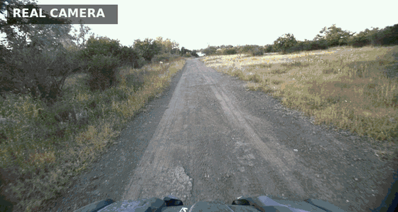
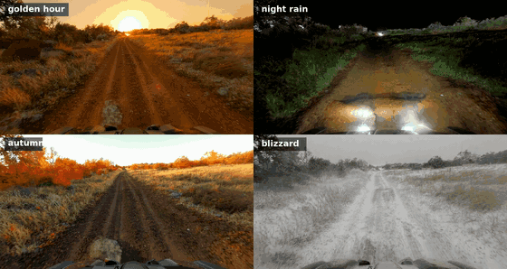
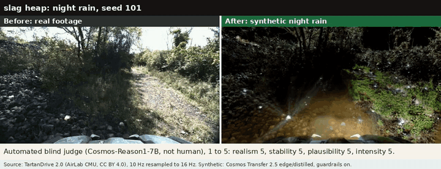
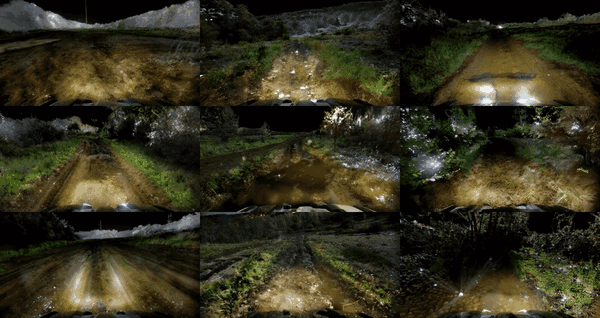
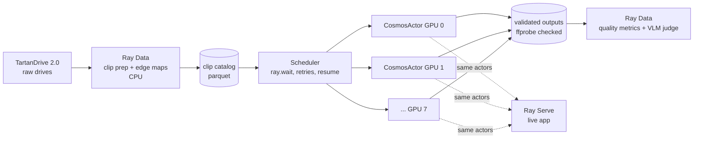
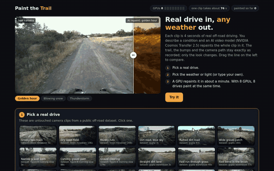

<div align="center">

# Every Season on Every Trail

**Off-road video augmentation with Ray and NVIDIA Cosmos Transfer 2.5**

Real ATV footage, re-rendered as golden hour, night rain, autumn, blizzard and more.<br>
The trail, the vehicle motion and the camera path stay those of the original recording.

[Interactive replay](https://paint-the-trail.pages.dev/replay/) · [Blog preview](https://paint-the-trail.pages.dev/) · [How to run](#how-to-run)



</div>

| **288 / 288** | **51.5 min** | **6.98x** | **100.9 s** |
|:---:|:---:|:---:|:---:|
| clips succeeded on the first attempt | full run on 8 A100s | generation speedup, 8 GPUs vs 1 | 8 drives in the live Ray Serve app |

## What it does

Off-road perception models need night rain, snow and smoke, and those conditions are scarce in recorded data.
This pipeline takes real clips from [TartanDrive 2.0](https://theairlab.org/TartanDrive2) (CMU AirLab, CC BY 4.0),
computes a Canny edge map for every frame, and asks [Cosmos Transfer 2.5](https://github.com/nvidia-cosmos/cosmos-transfer2.5)
to generate a new video that follows those edges under a text prompt. The edges keep the geometry; the prompt sets
light, weather, season and surface.

<p align="center">
  
  <br><sub>Golden hour, night rain, autumn and blizzard, generated from the same recording and edge map.</sub>
</p>

<p align="center">
  
  <br><sub>Source on the left, generated night rain on the right.</sub>
</p>

<p align="center">
  
  <br><sub>The same night rain prompt on nine drives. Headlight falloff and wet ground follow each trail's layout.</sub>
</p>

## How Ray runs it



| Layer | Ray piece | What it does |
|---|---|---|
| Clip prep | **Ray Data** | Decode, resample 10 Hz to 16 fps, encode, verify, precompute lossless edge controls on worker CPUs |
| Generation | **Ray Core actors** | One persistent actor per GPU owns a long-lived Cosmos child process (own torch/CUDA stack); the 2B model loads once |
| Scheduling | **`ray.wait`** | One request in flight per actor, infra retries on a replacement actor, per-request records for resume |
| Scoring | **Ray Data** | Edge F1 vs source, CIELAB chroma, frozen-frame checks, blind Cosmos-Reason1 judge |
| Live demo | **Ray Serve** | Same actors behind FastAPI; `@serve.multiplexed` routes a scene to the replica that already cached its latents |

<p align="center">
  
  <br><sub>The live Ray Serve app: pick a drive and a condition, then paint 8 drives on 8 GPUs (sped up).</sub>
</p>

## Results at a glance

| Actors (1x A100 each) | Wall time | Generation speedup | Median per request |
|---:|---:|---:|---:|
| 1 | 2067.75 s | 1.00x | 79.79 s |
| 2 | 1107.90 s | 1.96x | 80.19 s |
| 4 | 624.94 s | 3.75x | 80.26 s |
| 8 | 398.39 s | 6.98x | 80.27 s |

Denoising (4 steps, distilled edge model) is 79% of each 80 s request, so throughput scales with the number of GPUs.
All reported results use the Cosmos guardrails (text and video). Full numbers: [`docs/blog/blog.md`](docs/blog/blog.md),
static report: `results/report/index.html`.

## How to run

**Requirements:** a Ray 2.60 cluster with NVIDIA GPUs (80 GB class: A100, H100, B200), shared storage at
`/mnt/cluster_storage`, a Hugging Face account with access to `nvidia/Cosmos-Transfer2.5-2B` and `nvidia/Cosmos-Guardrail1`.

```bash
# 1. Image (Anyscale-builder compatible) and environments
docker build -t offroad-cosmos environments/            # or use environments/Dockerfile as an Anyscale image
UV_CACHE_DIR=/tmp/uv-cache bash environments/build_cosmos_env.sh   # isolated Cosmos 2.5 env on shared storage
uv venv --system-site-packages .venv && uv pip install -e '.[test]'
hf auth login

# 2. Check the cluster and stage checkpoints
.venv/bin/python -m offroad_ray.cli preflight
.venv/bin/python -m offroad_ray.cli env-check configs/pilot.yaml
.venv/bin/python jobs/stage_checkpoints.py

# 3. Data: download TartanDrive drives and prepare clips (Ray Data, CPU)
.venv/bin/python -m offroad_ray.cli fetch   configs/pilot.yaml
.venv/bin/python -m offroad_ray.cli prepare configs/pilot.yaml

# 4. Generate on all GPUs (resumable), then score
.venv/bin/python -m offroad_ray.cli generate configs/pilot.yaml --actors 8
.venv/bin/python -m offroad_ray.cli review   configs/pilot.yaml

# 5. Scale up, benchmark, report
.venv/bin/python -m offroad_ray.cli generate  configs/main.yaml
.venv/bin/python -m offroad_ray.cli benchmark configs/benchmark.yaml --actors 1 2 4 8
.venv/bin/python -m offroad_ray.cli report

# 6. Live app on Ray Serve
.venv/bin/python jobs/serve_demo.py up --replicas 8 --guardrails
.venv/bin/python jobs/serve_demo.py down
```

Conditions live in `configs/conditions*.yaml` (prompts per condition); `configs/conditions_v3.yaml` has the ten
extended ones (dust, golden hour glare, blue hour, blizzard, wildfire smoke, autumn, flooded mud, frost, night rain, drought).
For a guided version with notebooks and a GPU-free replay, see [`templates/cosmos-video-augmentation`](templates/cosmos-video-augmentation).

## Repository layout

```
configs/       run configs and condition prompt sets
environments/  Dockerfile, Cosmos 2.5 / Cosmos 3 env builders
jobs/          drivers: checkpoint staging, depth probe, latency profile, Serve launcher, bundling
src/offroad_ray/
  dataset/     download, clip planning, manifest
  inference/   CosmosActor, subprocess worker, scheduler
  quality/     metrics, review page, VLM judge
  reporting/   benchmark charts, montages, HTML report
  serve/       Ray Serve app + UI
templates/     Anyscale template version (notebooks, Serve app, CPU replay)
docs/          blog draft, media
```

## In progress

- **Depth control vs edge control** on B200s: the non-distilled depth model (35 steps) took 868 s per clip on an A100
  against 80 s for distilled edge.
- **Cosmos 3** transfer comparison on the same clips, prompts and seeds.

## Credits

Alicia Chua, Alexandr Plashchinsky, Nickhil Gupta, Abhishek Sriram, Abhishek Monangi, Omar Shorbaji.

Source footage: [TartanDrive 2.0](https://theairlab.org/TartanDrive2), AirLab, Carnegie Mellon University, CC BY 4.0.
Models: [NVIDIA Cosmos Transfer 2.5](https://github.com/nvidia-cosmos/cosmos-transfer2.5), Cosmos-Guardrail1,
Cosmos-Reason1-7B, Qwen3Guard. Code: Apache-2.0.
