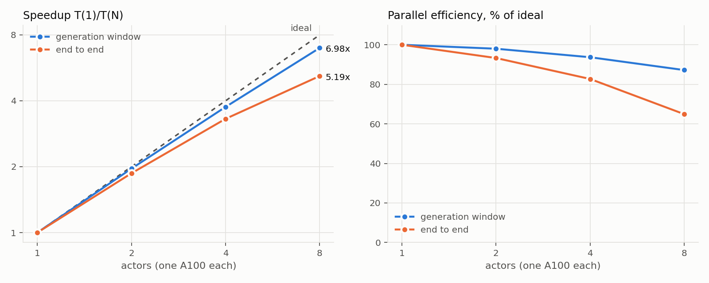
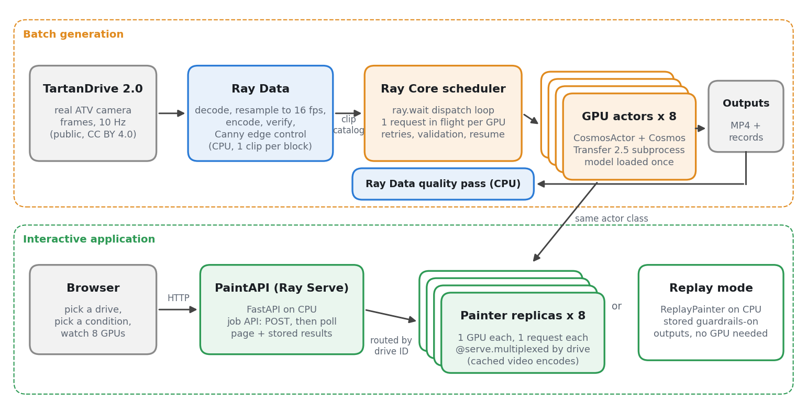

# Generate weather variations of real driving video with Ray and NVIDIA Cosmos Transfer 2.5

⏱️ Time to complete: 30 min without GPUs, 2 h with

**No GPU needed to start.** Every result in this README, and all 3 notebooks, run on CPU from stored results. GPUs are only needed to generate new clips: set `USE_GPUS = True` when you are ready.

Off-road perception models need examples of night rain, snow and smoke, yet these conditions are scarce in recorded driving data. This template takes real ATV footage from TartanDrive 2.0 [1] and uses NVIDIA Cosmos Transfer 2.5 [2] to generate new weather, lighting and seasons for each clip, while the terrain, vehicle motion and camera path stay true to the recording.


*A real 5.8-second recording followed by Cosmos Transfer 2.5 outputs for golden hour, night rain, autumn, blue hour, blizzard and rain, all generated from the same clip and its edge map.*

* **Data:** 27 clips from 9 TartanDrive 2.0 drives (CC BY 4.0), 93 frames each at 1024×544.
* **Model:** Cosmos Transfer 2.5, distilled edge control, 4 denoising steps, guardrails on.
* **Workflow on Ray [6]:** clip preparation and quality scoring with Ray Data, a pool of persistent GPU actors for generation, and an interactive Ray Serve application.

Interactive demo of the results: [paint-the-trail.pages.dev/replay](https://paint-the-trail.pages.dev/replay/)

## Start here

1. **Download the data bundle** (about 350 MB, 1 to 2 minutes): the 9 showcase drives in 10 conditions, plus every result file from the original study.

   ```bash
   python scripts/setup_data.py
   ```

2. **Open a notebook.** Each one stands alone:

   | Notebook | Ray library | What you do | Without GPUs (default) | With GPUs (`USE_GPUS = True`) |
   |---|---|---|---|---|
   | [01_prepare_and_generate.ipynb](01_prepare_and_generate.ipynb) | Ray Core, Ray Data | Tasks and actors, clip preparation, a pool of GPU actors, scaling from 1 to 8 GPUs | Stored 288-clip run and scaling benchmark | Prepares a drive and generates 2 conditions on 2 GPUs |
   | [02_quality_and_review.ipynb](02_quality_and_review.ipynb) | Ray Data | Scores outputs for structure, temporal stability and color; failure cases | Runs live on CPU over the bundled clips | Same |
   | [03_serve.ipynb](03_serve.ipynb) | Ray Serve | Deploys the interactive application and calls its API | Replay mode: the full application on CPU, preset conditions | Live generation on 8 GPU replicas |

3. **To generate live**, use the template image (it contains the Cosmos environment), set `HF_TOKEN` after accepting the NVIDIA Open Model License for the Cosmos models on Hugging Face, then:

   ```bash
   python scripts/setup_data.py --with-weights --with-raw   # about 40 GB of weights and 1.5 GB of footage
   ```

| Setting | Default | Meaning |
|---|---|---|
| `USE_GPUS` | `False` | Notebook setting. `True` generates live on GPUs |
| `COSMOS_SHARED` | `/mnt/user_storage/cosmos-video-augmentation` | Where data, weights and results live; readable by every node |

## Key findings

All results use guardrails on, 8 A100 80 GB GPUs on separate nodes.

* **288 clips in 51.5 minutes, every request successful on its first attempt**: 24 clips × 4 conditions × 3 seeds, with no out-of-memory errors or infrastructure failures.
* **Per-request time stays flat as GPUs are added**: the median request takes 79.79 s on 1 actor and 80.27 s with 8, for a 6.98x generation speedup (87% efficiency).
* **The sampler dominates**: the 4 denoising steps are 79% of each 80.3-second request, so throughput scales with the number of GPUs working in parallel.
* **Live generation**: the Ray Serve application generated 8 drives 100.9 seconds after one click.
* **Structure is preserved**: edge F1 against the source is 0.82 for snow, 0.78 for rain, 0.64 for night and 0.53 for fog, where fog hides distant edges by design.
* **Automated review is weak evidence**: a vision-language judge labeled most rain clips "overcast". Use human review for realism claims.



## System design on Ray



| Ray library | Role in this template |
|---|---|
| Ray Data | Prepares clips (decode, resample to 16 fps, encode, verify, edge control) and scores every output on CPU |
| Ray Core | 1 persistent actor per GPU. Each runs Cosmos Transfer 2.5 in its own Python environment as a long-lived subprocess, so the model loads once. A `ray.wait` loop keeps 1 request in flight per actor, retries infrastructure failures and resumes interrupted runs |
| Ray Serve | A FastAPI front end on CPU and GPU `Painter` replicas built on the same actor class. Drive IDs are multiplexed model IDs, so repeat requests for a drive reach a replica that has already encoded it |


*The application with guardrails on: pick a drive and a condition, and 8 GPUs generate in parallel. The generation period is shown at 12x speed.*

**Design choices**

* **Isolated model environment.** Cosmos pins its own PyTorch and CUDA stack. Running it in a subprocess owned by the actor keeps those dependencies away from Ray and the driver.
* **Scale out by clip.** Splitting one clip across GPUs on separate nodes was slower than a single GPU, because every step then crosses the network. Many clips in parallel is the efficient shape on 1-GPU nodes.
* **Cache what does not change.** The 2 video encodes per request depend only on the drive. They are cached on the GPU and reused exactly, and identical requests return stored outputs at once.


## Running at full scale

```bash
python -m offroad_ray.cli fetch     configs/main.yaml        # 9 drives, 13.4 GB
python -m offroad_ray.cli prepare   configs/main.yaml        # Ray Data, CPU
python -m offroad_ray.cli generate  configs/main.yaml        # 288 clips on 8 GPUs, about 52 min
python -m offroad_ray.cli review    configs/main.yaml        # quality pass, CPU
python -m offroad_ray.cli benchmark configs/benchmark.yaml --actors 1 2 4 8
anyscale job submit -f jobs/job.yaml                         # the same run as an Anyscale Job
anyscale service deploy -f jobs/service.yaml                 # the application as an Anyscale Service
```

Prompts live in `configs/conditions.yaml` (fog, rain, night, snow) and `configs/conditions_v3.yaml` (10 more conditions). Runs resume: rerunning a command only generates what is missing.

## Template layout

```
├── README.ipynb / README.md
├── 01_prepare_and_generate.ipynb   Ray Core, Ray Data preparation, GPU actor pool, scaling
├── 02_quality_and_review.ipynb     Ray Data quality pass, color, automated review, failure cases
├── 03_serve.ipynb                  Ray Serve application and API
├── notebook_helpers.py             Loading results, video frames and charts
├── serve_app.py                    Entry point for serve run and the Anyscale Service
├── offroad_ray/                    Preparation, generation, scheduling, quality and Serve code
├── configs/                        Experiment and prompt configuration
├── jobs/                           Anyscale Job and Service definitions
├── scripts/                        Data setup, Cosmos environment build, maintainer tools
├── tests/test_template.py          Checks the bundled results against the published figures
└── Dockerfile, requirements.txt
```

## Troubleshooting

| Symptom | Cause and fix |
|---|---|
| `Data not found` in a Setup cell | Run `python scripts/setup_data.py` |
| `Cosmos environment not READY` | Not on the template image. Use the image, or build the environment with `scripts/build_cosmos_env.sh` |
| Gated repository error while staging weights | Accept the NVIDIA Open Model License on each Cosmos model page and set `HF_TOKEN` |
| Out of memory on the first request | Use 80 GB GPUs: the first request on each actor peaks at 71 GB |
| Replay mode rejects a custom prompt | Replay mode only has stored outputs for the preset conditions. Set `USE_GPUS = True` to generate any prompt |

## Data sources and licenses

| Resource | Source | License |
|---|---|---|
| Driving footage | TartanDrive 2.0, AirLab, Carnegie Mellon University [1] | CC BY 4.0. Frames were resampled to 16 fps, re-encoded and used as conditioning for generated changes in appearance |
| Cosmos Transfer 2.5, Cosmos-Reason1, Cosmos-Guardrail1 | NVIDIA [2], [3], [4] | NVIDIA Open Model License; code Apache 2.0 |
| Qwen3Guard-Gen-0.6B, SigLIP | Qwen [5], Google [7] | Apache 2.0 |
| Ray | Anyscale and the Ray community [6] | Apache 2.0 |

## References

1. Sivaprakasam, M., Maheshwari, P., Guaman Castro, M., et al. TartanDrive 2.0: More Modalities and Better Infrastructure to Further Self-Supervised Learning Research in Off-Road Driving Tasks. arXiv:2402.01913 (2024). Dataset: theairlab.org/TartanDrive2
2. NVIDIA. World Simulation with Video Foundation Models for Physical AI. arXiv:2511.00062 (2025). Code: github.com/nvidia-cosmos/cosmos-transfer2.5
3. NVIDIA. Cosmos-Reason1: From Physical Common Sense To Embodied Reasoning. arXiv:2503.15558 (2025)
4. NVIDIA. Cosmos World Foundation Model Platform for Physical AI. arXiv:2501.03575 (2025)
5. Zhao, H., Yuan, C., Huang, F., et al. Qwen3Guard Technical Report. arXiv:2510.14276 (2025)
6. Moritz, P., Nishihara, R., Wang, S., et al. Ray: A Distributed Framework for Emerging AI Applications. OSDI (2018). arXiv:1712.05889
7. Zhai, X., Mustafa, B., Kolesnikov, A., Beyer, L. Sigmoid Loss for Language Image Pre-Training. arXiv:2303.15343 (2023)
